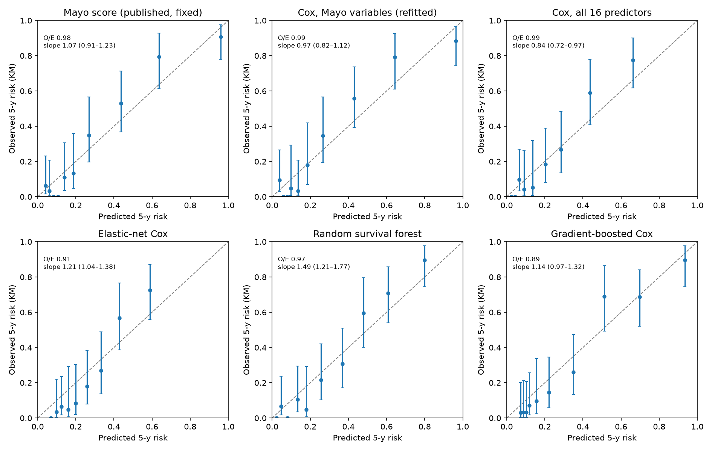
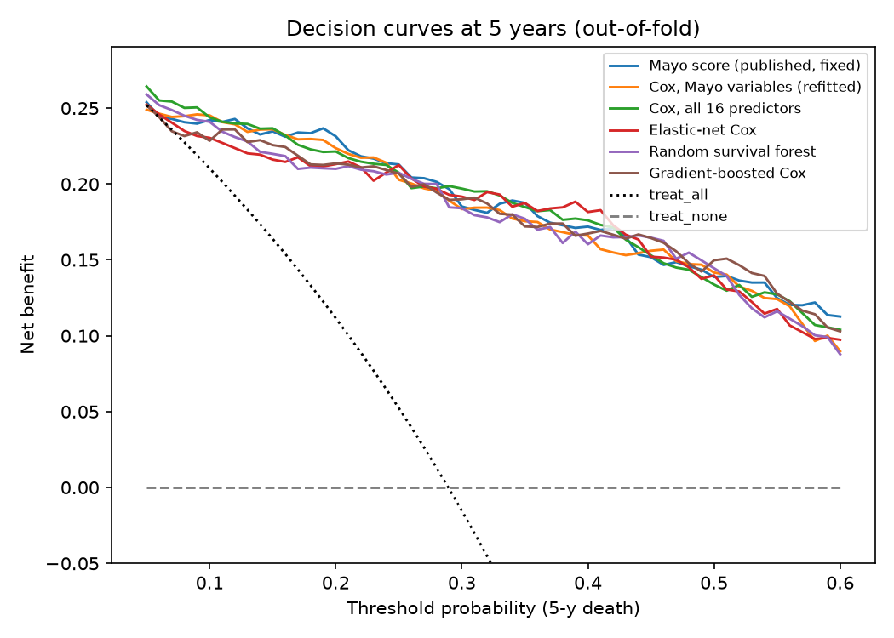
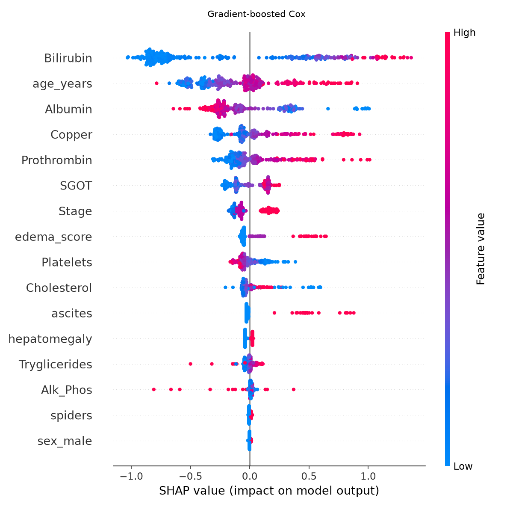
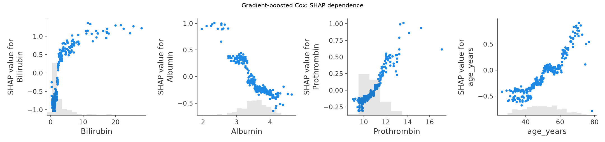
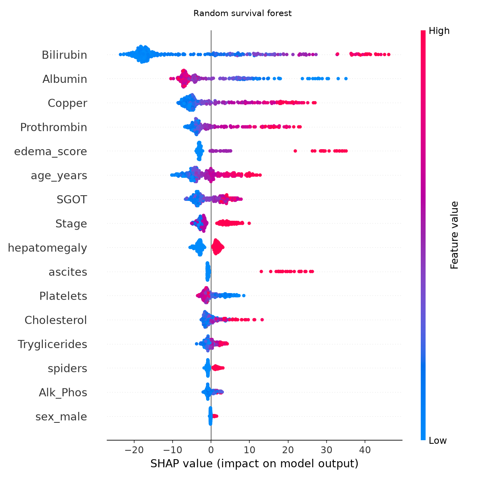
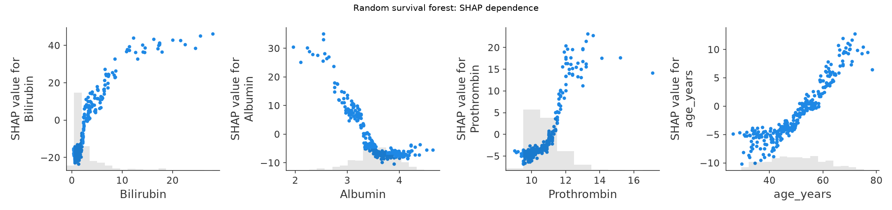
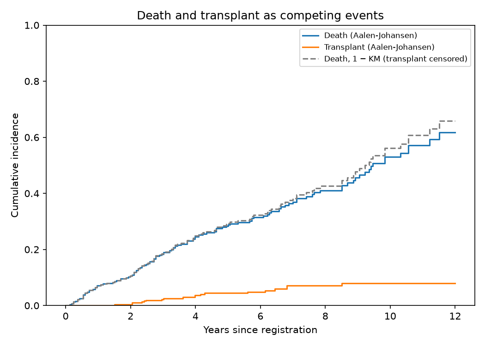

# Track A — Mayo PBC survival models: report

Generated by `uv run python -m cirrhosis_ml.pbc.run_all`. Open data (UCI 878, CC BY 4.0).
Phase 1 outputs (table 1, missingness, KM curves, apparent Mayo performance) are in `reports/pbc/`.

## Methods (summary)
- **Population:** 312 randomised trial patients (primary). **Outcome:** death; liver transplant
  censored. **Horizon:** 5 years for risk, calibration and decision curves.
- **Models:** published Mayo score (fixed); Cox on the 5 Mayo variables refitted in each fold;
  Cox, elastic-net Cox, random survival forest and gradient-boosted Cox on 16 candidate
  predictors (8 log-transformed labs). Imputation (chained equations) and scaling are fitted
  inside each training fold.
- **Validation:** repeated nested CV — outer 5-fold × 10 repeats (stratified on
  death), inner 3-fold grid search on the outer training fold only. Each patient's out-of-fold
  (OOF) 5-year risk is averaged over repeats; discrimination CIs are
  1000-resample percentile bootstraps of these OOF predictions (they ignore refitting
  variability, so are somewhat narrow). Averaging over repeats acts like a small ensemble, so
  per-repeat results (each a single CV pass) are shown as mean (range) alongside; fold-level
  mean (SD) is also given.
- The published Mayo score was fitted on these same patients (Dickson 1989), so its performance
  is **optimistic**; the refitted Mayo-variable Cox is the fair benchmark.

## Sample size (Riley et al. criteria; Python implementation)
|                                         |   R2_CS |   n_required |   events_required |    EPP |   available_n |   available_events |
|:----------------------------------------|--------:|-------------:|------------------:|-------:|--------------:|-------------------:|
| ('Mayo LR chi2 (optimistic)', 5)        |   0.472 |       92.000 |            37.000 |  7.400 |       312.000 |            125.000 |
| ('Mayo LR chi2 (optimistic)', 16)       |   0.472 |      292.000 |           117.000 |  7.300 |       312.000 |            125.000 |
| ('15% of max R2_CS (conservative)', 5)  |   0.118 |      357.000 |           143.000 | 28.600 |       312.000 |            125.000 |
| ('15% of max R2_CS (conservative)', 16) |   0.118 |     1143.000 |           458.000 | 28.600 |       312.000 |            125.000 |

## Discrimination (OOF, 95% bootstrap CI)
| model                          | Harrell C           | Uno C (τ=10 y)      | AUC 2 y             | AUC 5 y             | AUC 10 y            | Harrell C, per repeat mean (range)   | IBS (yearly 1–7 y), fold mean (SD)   | Harrell C, fold mean (SD)   |
|:-------------------------------|:--------------------|:--------------------|:--------------------|:--------------------|:--------------------|:-------------------------------------|:-------------------------------------|:----------------------------|
| Mayo score (published, fixed)  | 0.843 (0.797–0.880) | 0.811 (0.770–0.853) | 0.870 (0.781–0.941) | 0.917 (0.872–0.955) | 0.863 (0.796–0.923) | 0.843 (0.843–0.843)                  | 0.092 (0.013)                        | 0.844 (0.038)               |
| Cox, Mayo variables (refitted) | 0.839 (0.793–0.876) | 0.807 (0.765–0.849) | 0.868 (0.777–0.939) | 0.909 (0.864–0.949) | 0.857 (0.788–0.919) | 0.837 (0.832–0.841)                  | 0.097 (0.013)                        | 0.840 (0.039)               |
| Cox, all 16 predictors         | 0.849 (0.812–0.882) | 0.812 (0.770–0.854) | 0.890 (0.816–0.948) | 0.922 (0.887–0.955) | 0.850 (0.772–0.914) | 0.844 (0.833–0.852)                  | 0.096 (0.012)                        | 0.847 (0.034)               |
| Elastic-net Cox                | 0.855 (0.819–0.887) | 0.817 (0.774–0.856) | 0.899 (0.826–0.955) | 0.924 (0.889–0.958) | 0.846 (0.769–0.910) | 0.853 (0.845–0.859)                  | 0.096 (0.011)                        | 0.857 (0.033)               |
| Random survival forest         | 0.835 (0.797–0.870) | 0.805 (0.761–0.848) | 0.866 (0.787–0.930) | 0.908 (0.866–0.946) | 0.864 (0.793–0.923) | 0.833 (0.826–0.836)                  | 0.101 (0.012)                        | 0.838 (0.038)               |
| Gradient-boosted Cox           | 0.831 (0.789–0.869) | 0.797 (0.752–0.842) | 0.861 (0.773–0.932) | 0.903 (0.860–0.944) | 0.860 (0.792–0.919) | 0.825 (0.811–0.833)                  | 0.100 (0.014)                        | 0.828 (0.038)               |

## Paired difference vs the refitted Mayo-variable Cox (model − benchmark, 95% bootstrap CI)
A CI that excludes 0 indicates a difference on the same patients. These are descriptive,
unadjusted comparisons (5 models × 5 metrics); no multiplicity correction.

| model                         | Harrell C             | Uno C (τ=10 y)        | AUC 2 y               | AUC 5 y               | AUC 10 y              |
|:------------------------------|:----------------------|:----------------------|:----------------------|:----------------------|:----------------------|
| Mayo score (published, fixed) | 0.005 (0.001–0.008)   | 0.004 (-0.002–0.009)  | 0.002 (-0.004–0.008)  | 0.008 (0.002–0.013)   | 0.005 (-0.004–0.015)  |
| Cox, all 16 predictors        | 0.010 (-0.003–0.023)  | 0.005 (-0.013–0.021)  | 0.022 (0.002–0.046)   | 0.012 (-0.007–0.031)  | -0.008 (-0.039–0.021) |
| Elastic-net Cox               | 0.016 (0.002–0.031)   | 0.009 (-0.010–0.026)  | 0.031 (0.009–0.057)   | 0.015 (-0.004–0.036)  | -0.012 (-0.046–0.019) |
| Random survival forest        | -0.003 (-0.020–0.014) | -0.002 (-0.028–0.021) | -0.002 (-0.032–0.030) | -0.001 (-0.022–0.023) | 0.007 (-0.039–0.047)  |
| Gradient-boosted Cox          | -0.008 (-0.022–0.007) | -0.011 (-0.033–0.011) | -0.007 (-0.030–0.014) | -0.006 (-0.023–0.013) | 0.003 (-0.034–0.037)  |

## Calibration at 5 years (OOF)
Slope < 1: predictions too extreme (overfitting); > 1: too conservative. Averaging OOF risks over
repeats compresses their spread a little (raising the slope), so the mean of per-repeat slopes is
also shown.

|                                | O/E (5 y)   | Calibration slope (95% CI)   | O/E, per repeat mean (range)   | Slope, per repeat mean (range)   |
|:-------------------------------|:------------|:-----------------------------|:-------------------------------|:---------------------------------|
| Mayo score (published, fixed)  | 0.98        | 1.07 (0.91–1.23)             | 0.98 (0.98–0.98)               | 1.07 (1.07–1.07)                 |
| Cox, Mayo variables (refitted) | 0.99        | 0.97 (0.82–1.12)             | 0.99 (0.98–1.00)               | 0.95 (0.86–1.01)                 |
| Cox, all 16 predictors         | 0.99        | 0.84 (0.72–0.97)             | 0.99 (0.98–1.00)               | 0.82 (0.76–0.85)                 |
| Elastic-net Cox                | 0.91        | 1.21 (1.04–1.38)             | 0.91 (0.90–0.93)               | 1.16 (0.93–1.27)                 |
| Random survival forest         | 0.97        | 1.49 (1.21–1.77)             | 0.97 (0.96–0.99)               | 1.43 (1.37–1.52)                 |
| Gradient-boosted Cox           | 0.89        | 1.14 (0.97–1.32)             | 0.89 (0.88–0.90)               | 0.92 (0.81–1.13)                 |

## Decision-curve analysis at 5 years (net benefit, OOF)
|   threshold |   Mayo score (published, fixed) |   Cox, Mayo variables (refitted) |   Cox, all 16 predictors |   Elastic-net Cox |   Random survival forest |   Gradient-boosted Cox |   treat_all |   treat_none |
|------------:|--------------------------------:|---------------------------------:|-------------------------:|------------------:|-------------------------:|-----------------------:|------------:|-------------:|
|       0.100 |                           0.242 |                            0.245 |                    0.244 |             0.230 |                    0.241 |                  0.228 |       0.210 |        0.000 |
|       0.200 |                           0.231 |                            0.224 |                    0.221 |             0.213 |                    0.210 |                  0.214 |       0.112 |        0.000 |
|       0.300 |                           0.185 |                            0.183 |                    0.197 |             0.192 |                    0.184 |                  0.190 |      -0.015 |        0.000 |
|       0.400 |                           0.172 |                            0.166 |                    0.176 |             0.182 |                    0.160 |                  0.167 |      -0.185 |        0.000 |

## Refitted Mayo-variable Cox vs Dickson 1989 (coefficients per original unit, n = 312)
|                 |   refit_312 |   dickson_initial_312 |
|:----------------|------------:|----------------------:|
| log_Bilirubin   |       0.879 |                 0.879 |
| log_Albumin     |      -3.053 |                -3.053 |
| log_Prothrombin |       3.016 |                 3.016 |
| age_years       |       0.033 |                 0.033 |
| edema_score     |       0.785 |                 0.785 |

## Proportional-hazards checks (Schoenfeld, rank time; final models on all 312)
**Mayo-variable Cox**

|                 |   test_statistic |     p |
|:----------------|-----------------:|------:|
| log_Prothrombin |            5.448 | 0.020 |
| edema_score     |            3.122 | 0.077 |
| log_Bilirubin   |            2.911 | 0.088 |
| age_years       |            0.437 | 0.509 |
| log_Albumin     |            0.161 | 0.688 |

**Cox, all 16 predictors** (lowest p-values)

|                 |   test_statistic |     p |
|:----------------|-----------------:|------:|
| log_Prothrombin |            3.764 | 0.052 |
| log_Copper      |            3.525 | 0.060 |
| log_Cholesterol |            1.260 | 0.262 |
| Stage           |            1.240 | 0.265 |
| hepatomegaly    |            1.176 | 0.278 |
| edema_score     |            0.986 | 0.321 |

## Explainability (final models refitted on all 312 — apparent, descriptive only)
Permutation importance = mean drop in Harrell's C when a predictor is shuffled (20 repeats),
computed on the training data: forests and boosting fit these data almost perfectly, so their
importances are inflated and not comparable in size with the Cox models — read the ranking only.

|               |   Cox, all 16 predictors |   Elastic-net Cox |   Random survival forest |   Gradient-boosted Cox |
|:--------------|-------------------------:|------------------:|-------------------------:|-----------------------:|
| Bilirubin     |                   0.0687 |            0.0440 |                   0.0651 |                 0.0877 |
| age_years     |                   0.0219 |            0.0141 |                   0.0194 |                 0.0331 |
| Copper        |                   0.0128 |            0.0171 |                   0.0222 |                 0.0194 |
| Stage         |                   0.0111 |            0.0056 |                   0.0076 |                 0.0043 |
| Prothrombin   |                   0.0102 |            0.0101 |                   0.0123 |                 0.0100 |
| SGOT          |                   0.0087 |            0.0076 |                   0.0094 |                 0.0068 |
| Albumin       |                   0.0078 |            0.0063 |                   0.0216 |                 0.0178 |
| edema_score   |                   0.0061 |            0.0048 |                   0.0095 |                 0.0022 |
| ascites       |                   0.0015 |            0.0037 |                   0.0070 |                 0.0066 |
| Cholesterol   |                   0.0010 |            0.0004 |                   0.0111 |                 0.0056 |
| hepatomegaly  |                   0.0009 |            0.0018 |                   0.0042 |                -0.0004 |
| sex_male      |                   0.0007 |            0.0001 |                   0.0001 |                 0.0001 |
| Platelets     |                   0.0000 |            0.0002 |                   0.0059 |                 0.0023 |
| spiders       |                   0.0000 |            0.0003 |                   0.0018 |                 0.0004 |
| Alk_Phos      |                  -0.0001 |           -0.0000 |                   0.0038 |                 0.0062 |
| Tryglicerides |                  -0.0003 |            0.0002 |                   0.0049 |                 0.0014 |

## Sensitivity analyses (5 repeats; point estimates on OOF risk, no CIs)
The published Mayo score was fitted on all 418 patients (death outcome), so its rows are
apparent performance; in the composite analysis it predicts death, not death-or-transplant.

|                                                                            | n   | events   | harrell_c   | uno_c   | td_auc_5   | O/E   | slope   |
|:---------------------------------------------------------------------------|:----|:---------|:------------|:--------|:-----------|:------|:--------|
| ('All 418 (imputation in folds)', 'Mayo score (published, fixed)')         | 418 | 161      | 0.836       | 0.806   | 0.908      | 0.993 | 1.047   |
| ('All 418 (imputation in folds)', 'Cox, Mayo variables (refitted)')        | 418 | 161      | 0.831       | 0.8     | 0.901      | 0.985 | 0.982   |
| ('All 418 (imputation in folds)', 'Cox, all 16 predictors')                | 418 | 161      | 0.836       | 0.8     | 0.907      | 0.979 | 0.876   |
| ('All 418 (imputation in folds)', 'Elastic-net Cox')                       | 418 | 161      | 0.84        | 0.807   | 0.909      | 0.922 | 1.231   |
| ('All 418 (imputation in folds)', 'Random survival forest')                | 418 | 161      | 0.831       | 0.802   | 0.9        | 0.976 | 1.447   |
| ('All 418 (imputation in folds)', 'Gradient-boosted Cox')                  | 418 | 161      | 0.825       | 0.788   | 0.894      | 0.894 | 1.175   |
| ('Composite: death or transplant (312)', 'Mayo score (published, fixed)')  | 312 | 144      | 0.819       | 0.788   | 0.897      | 1.116 | 0.981   |
| ('Composite: death or transplant (312)', 'Cox, Mayo variables (refitted)') | 312 | 144      | 0.818       | 0.788   | 0.895      | 0.996 | 0.974   |
| ('Composite: death or transplant (312)', 'Cox, all 16 predictors')         | 312 | 144      | 0.831       | 0.796   | 0.91       | 0.99  | 0.847   |
| ('Composite: death or transplant (312)', 'Elastic-net Cox')                | 312 | 144      | 0.836       | 0.8     | 0.915      | 0.928 | 1.124   |
| ('Composite: death or transplant (312)', 'Random survival forest')         | 312 | 144      | 0.82        | 0.792   | 0.898      | 0.984 | 1.451   |
| ('Composite: death or transplant (312)', 'Gradient-boosted Cox')           | 312 | 144      | 0.808       | 0.774   | 0.886      | 0.898 | 1.001   |

### Transplant as a competing event
Observed 5-year death risk per decile of OOF predicted risk: Kaplan–Meier
(transplant censored) vs Aalen–Johansen cumulative incidence (transplant competing).

| model                          |   mean |pred − KM| over deciles |   mean |pred − AJ| over deciles | top decile: pred / KM / AJ   |
|:-------------------------------|--------------------------------:|--------------------------------:|:-----------------------------|
| Cox, Mayo variables (refitted) |                           0.079 |                           0.075 | 0.96 / 0.88 / 0.88           |
| Cox, all 16 predictors         |                           0.059 |                           0.061 | 0.96 / nan / 0.88            |
| Gradient-boosted Cox           |                           0.066 |                           0.061 | 0.94 / 0.90 / 0.90           |

## Limitations
- Small sample (312 patients, 125 deaths) from a single 1974–84 trial; see sample-size table.
- No external validation; OOF bootstrap CIs understate model-refitting uncertainty.
- Single deterministic chained-equations imputation per fold (not multiple imputation with
  Rubin's rules).
- Fine–Gray models not fitted (no mature Python implementation); competing risks are handled
  descriptively with Aalen–Johansen.
